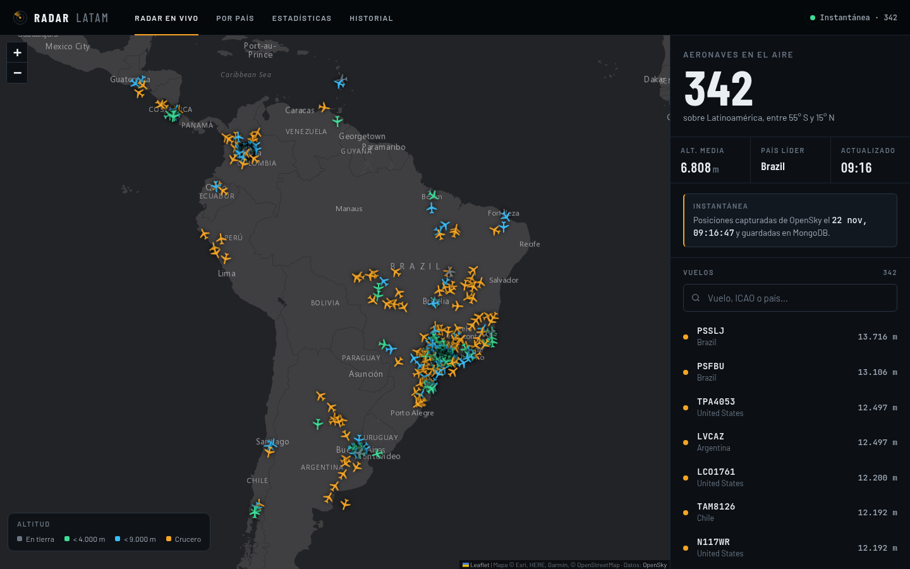
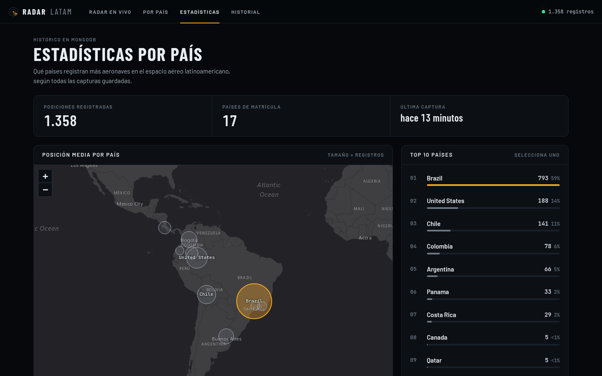
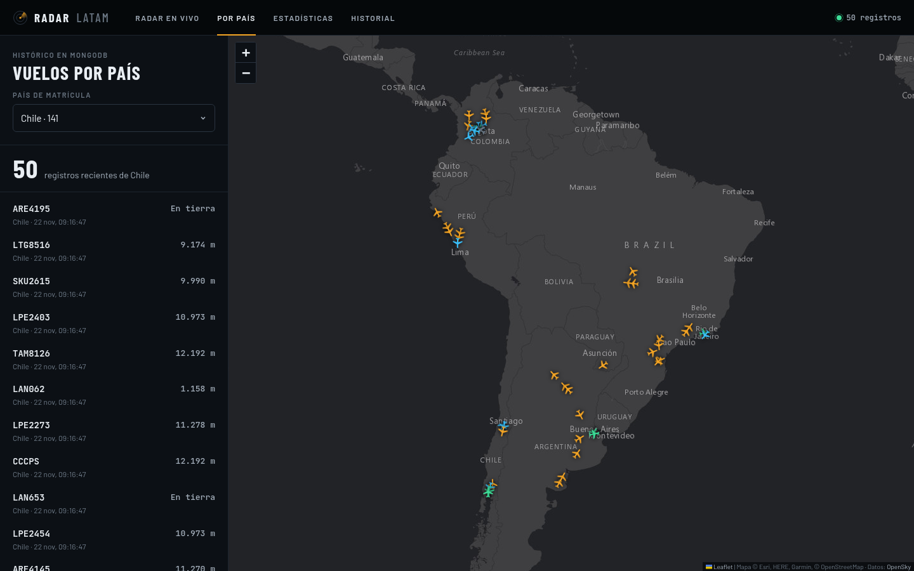
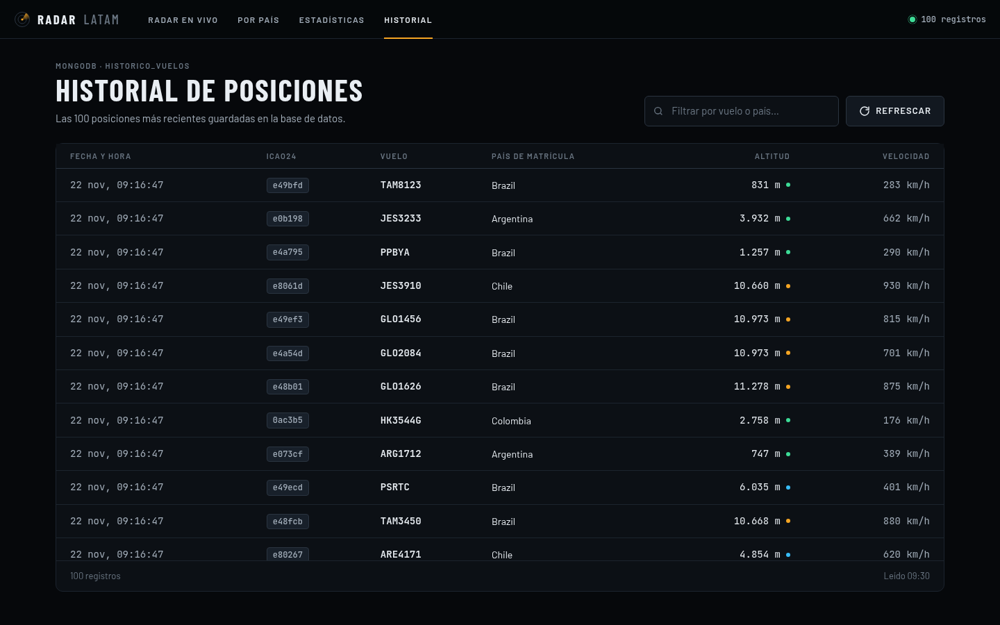

# Radar Latam — Real-Time Flight Tracking over Latin America

> 🇪🇸 [Versión en español](README.es.md)

**Radar Latam** tracks the aircraft flying over Latin America in real time. It pulls live positions from the [OpenSky Network](https://opensky-network.org) API, keeps the current state in **Redis**, stores every capture in **MongoDB**, and shows everything on an interactive dark-themed map.

The project demonstrates a two-layer data architecture:
- a fast, short-lived **live layer** in Redis;
- a durable **history layer** in MongoDB that you can query and aggregate.

### 🌐 Live demo: **[amamemie.github.io/rastreo-global-vuelos](https://amamemie.github.io/rastreo-global-vuelos/)**

The demo is a static snapshot of the database, so it runs without a server. Running the app locally gives you live data.



---

## Features

| View | What it does |
|---|---|
| **Live radar** (`/`) | Full-screen map of every aircraft between 55° S and 15° N. Each plane points in its real heading and is colored by altitude. A side panel shows the aircraft count, average altitude, the leading country, and a searchable flight list. Clicking a flight flies the map to it. |
| **By country** (`/filtro_paises`) | Filters the stored history by country of registration. The selected country is kept in the URL (`?pais=Chile`), so you can share a link to it. |
| **Statistics** (`/estadisticas`) | Shows totals (positions stored, countries, last capture) and a top-10 ranking of countries. Each country also appears as a bubble on the map, sized by its number of records. All figures come from a MongoDB aggregation. |
| **History** (`/historial`) | Lists the 100 most recent positions stored in MongoDB, with filtering, altitude, and speed. |

| Statistics | By country | History |
|---|---|---|
|  |  |  |

---

## How it works

```
                 ┌──────────────────────┐
                 │  OpenSky Network API │  live aircraft states (OAuth2 or anonymous)
                 └──────────┬───────────┘
                            │  every refresh / every 60 s
              ┌─────────────┴─────────────┐
              │ Flask app  ·  app_ingestor│
              └──────┬─────────────┬──────┘
                     │             │
      SET key EX 300 │             │ insert_many
                     ▼             ▼
            ┌──────────────┐ ┌──────────────────┐
            │    Redis     │ │     MongoDB      │
            │  live layer  │ │  history layer   │
            │ (5 min TTL)  │ │  + aggregations  │
            └──────┬───────┘ └────────┬─────────┘
                   └───────┬──────────┘
                           ▼
                 ┌───────────────────┐        exportar_estatico.py
                 │ Web UI (Leaflet)  │ ─────────────────────────────▶  docs/  →  GitHub Pages
                 └───────────────────┘        (JSON snapshot)
```

1. **Ingestion.** Pressing **Refresh radar** in the UI (or running `app_ingestor.py`) calls OpenSky's `/states/all` endpoint for the Latin American bounding box.
2. **Live layer (Redis).** Each aircraft is stored as `vuelo_live:<icao24>` with a 5-minute expiry. Planes that stop reporting disappear automatically.
3. **History layer (MongoDB).** Every capture is appended to `rastreo_logistica.historico_vuelos`. The statistics and filter views query this collection, using aggregation pipelines with `$group`, `$avg`, and `$sort`.
4. **Frontend.** Server-rendered Jinja templates plus vanilla JavaScript call the Flask JSON API and draw the data with Leaflet.
5. **Static export.** `exportar_estatico.py` dumps a MongoDB snapshot to JSON and renders the same pages in "static mode" into `docs/`, which GitHub Pages serves.

### Stored document

```json
{
  "icao24": "e48ea7",
  "callsign": "AZU4333",
  "pais": "Brazil",
  "latitud": -25.0501,
  "longitud": -48.0355,
  "altitud": 5486.4,
  "velocidad": 129.06,
  "rumbo": 214.5,
  "en_tierra": false,
  "timestamp": "2026-11-22 08:59:03"
}
```

Field names are Spanish: `pais` = country, `altitud` = altitude in meters, `velocidad` = speed in m/s, `rumbo` = heading in degrees, `en_tierra` = on the ground.

---

## Tech stack

| Layer | Technology |
|---|---|
| Backend | **Python 3.13**, **Flask 3.1**, Requests, Gunicorn |
| Live data store | **Redis 7** (redis-py) |
| Historical data store | **MongoDB 7** (PyMongo) |
| Data source | **OpenSky Network REST API** (OAuth2 client credentials, anonymous fallback) |
| Frontend | HTML + Jinja2 templates, vanilla JavaScript, custom CSS design system |
| Maps | **Leaflet 1.9**, Esri Dark Gray Canvas tiles |
| Fonts | Barlow, Barlow Condensed, JetBrains Mono (Google Fonts) |
| Infrastructure | **Docker Compose** for MongoDB and Redis; **GitHub Pages** for the static demo; Render blueprint included for a full deployment |

---

## Getting started

### Requirements
- Python 3.10+
- Docker with Docker Compose (or MongoDB and Redis installed locally)

### Run it

```bash
git clone https://github.com/amamemie/rastreo-global-vuelos.git
cd rastreo-global-vuelos

docker compose up -d                 # start MongoDB (27017) and Redis (6379)

python -m venv venv
source venv/bin/activate             # Windows: venv\Scripts\activate
pip install -r requirements.txt

python app.py                        # open http://localhost:5000
```

Then press **Refresh radar** on the main page to load the current traffic.

Optionally, run the background ingestor in a second terminal. It captures new positions every 60 seconds:

```bash
python app_ingestor.py
```

### OpenSky credentials (optional)

The app works without an account by using OpenSky's anonymous access, which has a smaller daily quota. For a higher quota, create an **API client** in your OpenSky account. Then either:
- save it as `credentials.json` (ignored by git):
  ```json
  { "clientId": "your-client-id", "clientSecret": "your-client-secret" }
  ```
- or set the environment variables `OPENSKY_CLIENT_ID` and `OPENSKY_CLIENT_SECRET`.

### Configuration

| Variable | Default | Purpose |
|---|---|---|
| `MONGO_URI` | `mongodb://localhost:27017/` | MongoDB connection string |
| `MONGO_DB` | `rastreo_logistica` | Database name |
| `REDIS_URL` | `redis://localhost:6379/1` | Redis connection URL |
| `INTERVALO_MIN_ACTUALIZAR` | `60` | Minimum seconds between OpenSky requests, so visitors cannot exhaust the quota |
| `PORT` / `FLASK_DEBUG` | `5000` / `1` | Server port and debug mode |

---

## REST API

| Method | Endpoint | Returns |
|---|---|---|
| `POST` | `/api/actualizar_vuelos` | Fetches OpenSky and saves to Redis and MongoDB. Limited to one request per minute. |
| `GET` | `/api/vuelos` | Aircraft currently in the Redis live layer |
| `GET` | `/api/historial_datos` | 100 most recent positions from MongoDB |
| `GET` | `/api/top_paises` | Top 10 countries by records, with average position (aggregation) |
| `GET` | `/api/vuelos_por_pais?pais=<name>` | 50 most recent positions for one country |
| `GET` | `/api/resumen` | Total records, number of countries, last capture time |

---

## Deployment

### Static snapshot on GitHub Pages (no server)

```bash
python exportar_estatico.py          # with MongoDB running; regenerates docs/
git add docs && git commit -m "Update snapshot" && git push
```

In the repository settings, set GitHub Pages to **Branch: `main`, folder: `/docs`**.

### Full live app (free tiers)

The repository includes a `render.yaml` blueprint:
1. Create a free **MongoDB Atlas** M0 cluster and a free **Upstash** Redis database.
2. On **Render**, choose *New → Blueprint* and select this repository.
3. Set `MONGO_URI`, `REDIS_URL` and, optionally, the OpenSky credentials.

---

## Project structure

```
├── app.py                  # Flask app: pages + JSON API
├── app_ingestor.py         # Background ingestor (polls OpenSky every 60 s)
├── opensky.py              # OpenSky client: OAuth2 token, anonymous fallback
├── database.py             # MongoDB and Redis connections (env-configurable)
├── exportar_estatico.py    # Exports a MongoDB snapshot + static pages to docs/
├── templates/              # Jinja templates (base layout + 4 views)
├── static/                 # Shared CSS design system and JS helpers
├── docs/                   # Generated static site served by GitHub Pages
├── screenshots/            # Images used in this README
├── docker-compose.yml      # MongoDB + Redis for local development
├── render.yaml             # Render deployment blueprint
└── requirements.txt
```

---

## Data attribution

Flight data: [The OpenSky Network](https://opensky-network.org). Map tiles: © Esri, HERE, Garmin, © OpenStreetMap contributors.
